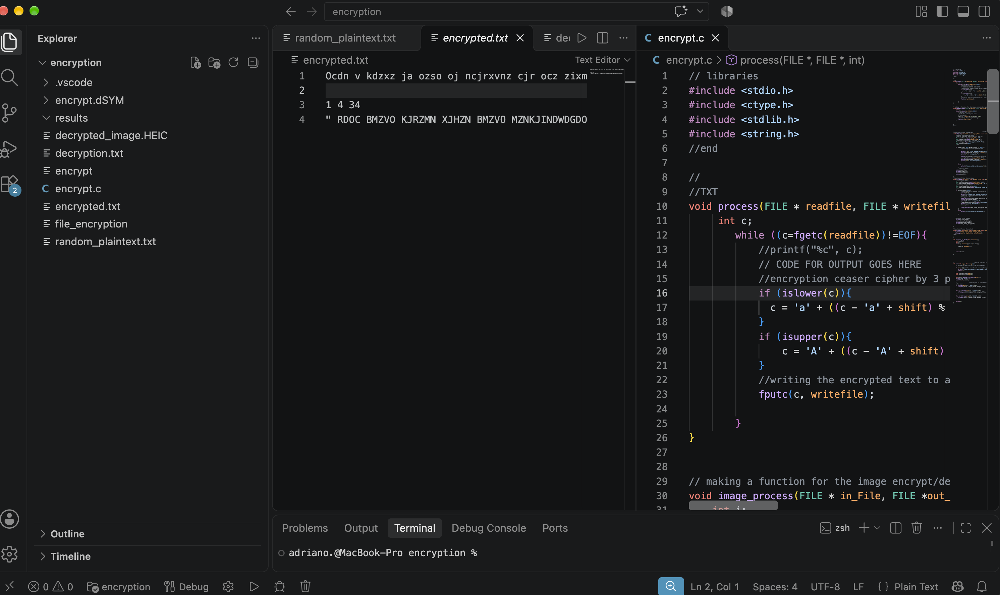

 # File Encryption Tool

A command-line program written in C that encrypts and decrypts both text files and images using a password-derived shift cipher.




## why i built it 
To Further understand the material of my cryptography class i created the and also to use and develop my C skills.
## What it does
- It encrypts  text files with a caesar cipher(shifts letters, leaves other characters alone)
- encrypts images by shifting every byte(works on any files)
- The shift amount comes from the password given( it adds up the ASCII values of the characters the user types)

## How to run it

Compile:

```bash
gcc encrypt.c -o encrypt
```

Run with four arguments:

```bash
./encrypt [password] [text|image|both] [input file] [output file]
```

Examples:

```bash
./encrypt mypassword text plaintext.txt encrypted.txt
./encrypt mypassword image swag.HEIC encrypted.HEIC
```

Arguments:

|Argument|Meaning|
|---|---|
|`password`|Any word; its characters set the cipher's shift value|
|`text` / `image` / `both`|Which mode to run|
|`input file`|The file to encrypt|
|`output file`|Where the encrypted result is written|

## Output files

- Text mode writes the encrypted file and a `decryption.txt` verification copy.
- Image mode writes the encrypted image and a `decrypted_image.HEIC` verification copy.

## How it works

A password like `cat` becomes a shift of `99 + 97 + 116 = 312`. Text mode wraps that within the 26 letters of the alphabet; image mode wraps it within 256 byte values. Decryption applies the same shift in the opposite direction.

## Built with

- C (standard library only: `stdio.h`, `ctype.h`, `stdlib.h`, `string.h`)

## Limitations

- Caesar cipher is an old and outdated method of encryption and should not be used to encrypt real sensitive data.